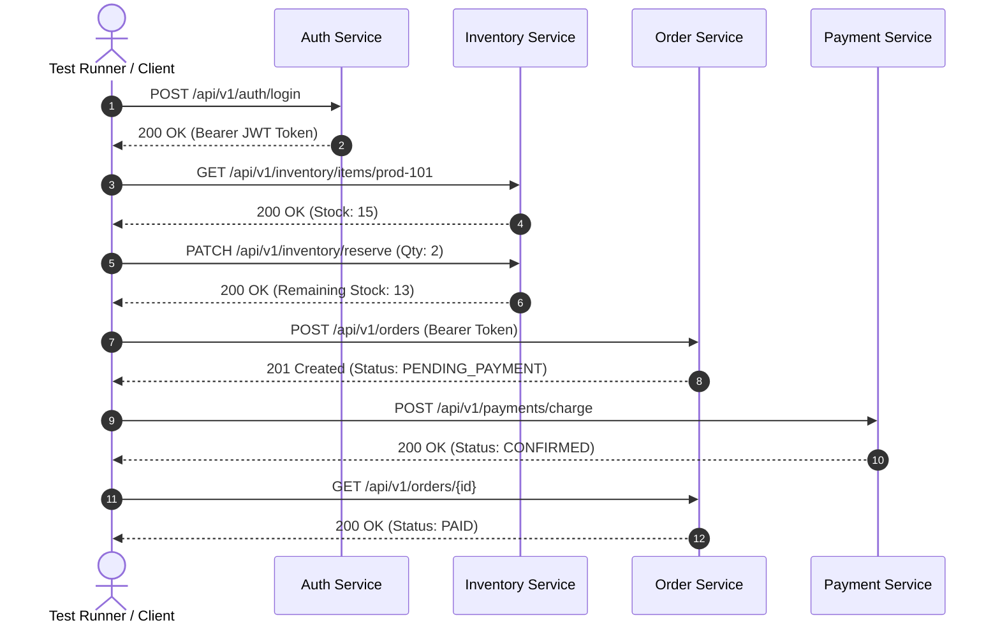

# ⚡ Microservices Test Automation & Chaos Engineering Framework (SDET-2)

[](https://www.typescriptlang.org/)
[](https://playwright.dev/)
[](https://zod.dev/)
[](https://opensource.org/licenses/MIT)

An enterprise-grade **Microservice Quality Automation Framework** demonstrating the top competencies tested in senior SDET interviews:
* **Consumer-Driven Contract Testing** across microservice boundaries.
* **Distributed Multi-Service Workflow Testing** (Auth $\to$ Inventory $\to$ Order $\to$ Payment).
* **Chaos Engineering & Resilience Testing** (simulating 503 Gateway outages, retries with backoff, stock conflict handling).
* **Embedded Lightweight Microservices Gateway** (zero external dependencies, runs instantly on any machine).

---

## 🏗️ Microservices Architecture



---

## 📂 Project Directory Structure

```text
sdet-mini-projects-2/
│
├── mock-server/                       # 🌐 Embedded Microservices Mock Gateway
│   ├── server.ts                      # Multi-service simulation (Auth, Inventory, Order, Payment)
│   └── start.ts                       # Gateway bootstrap runner
│
├── src/
│   ├── clients/                       # 🔌 Strongly-Typed API Clients
│   │   └── MicroserviceClients.ts     # Auth, Inventory, Order, Payment clients
│   ├── contracts/                     # 📜 Zod Contract Schemas
│   │   └── serviceContracts.ts        # Enforces request/response data contracts
│   └── fixtures/                      # 🧪 Custom Test Fixtures
│       └── microserviceFixtures.ts    # Dependency injection & automated gateway lifecycle
│
├── tests/
│   ├── contracts/                     # 🔍 Contract Validation Tests
│   │   └── service-contracts.spec.ts  # Validates schemas across service boundaries
│   ├── integration/                   # 🔄 Multi-Service Orchestration Tests
│   │   └── order-fulfillment-flow.spec.ts # Full purchase & payment workflow across 4 services
│   └── resilience/                    # 💥 Chaos & Resilience Engineering Tests
│       └── chaos-resilience.spec.ts   # 503 outage simulation, backoff retries, 409 conflict
│
├── docs/
│   └── MICROSERVICES_TEST_STRATEGY.md # Formal microservices test strategy document
├── playwright.config.ts               # Test configuration with automated webServer hook
└── tsconfig.json                      # Strict NodeNext TypeScript configuration
```

---

## ⚡ Quick Start & Execution

### 1. Build the Project
```bash
npm install
npm run build
```

### 2. Run All Microservice Tests
```bash
# Runs contract, integration, and resilience tests (under 3 seconds)
npm test
```

### 3. Run Specific Test Suites
```bash
# Run only contract schema validation tests
npm run test:contracts

# Run distributed multi-service flow
npm run test:integration

# Run chaos engineering and resilience tests
npm run test:resilience
```

---

## 📄 Documentation
* [Microservices Quality Engineering Strategy](docs/MICROSERVICES_TEST_STRATEGY.md)
