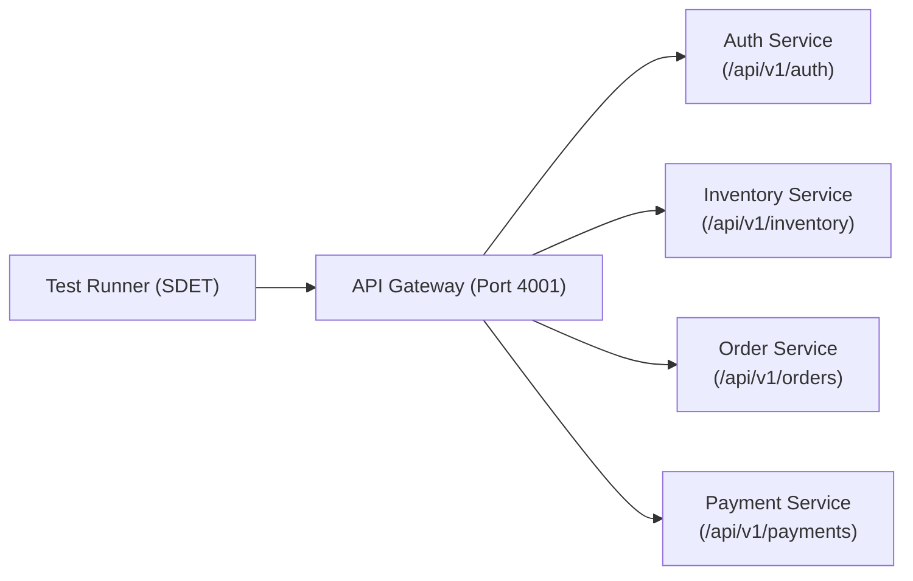

# Microservices Quality Engineering & Resilience Strategy

## 1. Architecture Overview
This framework demonstrates testing strategies for modern distributed systems and microservices architectures. In a microservice ecosystem, testing cannot rely solely on end-to-end clicks due to network volatility, distributed state, and cross-service dependencies.

---

## 2. Testing Pillars

### 2.1 Consumer-Driven Contract Testing (Zod)
* **Problem**: When one team updates a microservice API response, downstream services often break silently in production.
* **Solution**: Runtime contract enforcement via strict Zod schemas. Every service endpoint is validated against its defined schema before deployment.

### 2.2 Distributed Transaction Orchestration (Saga Pattern Verification)
* Tests multi-step cross-service workflows:
  1. **Authentication**: Client obtains a signed Bearer token.
  2. **Inventory Check**: Verifies product stock availability.
  3. **Stock Reservation**: Locks inventory to prevent race conditions (`PATCH /inventory/reserve`).
  4. **Order Creation**: Generates order in `PENDING_PAYMENT` status.
  5. **Payment Processing**: Executes charge and transitions order status to `PAID`.

### 2.3 Chaos Engineering & Fault Tolerance
* **Failure Injection**: Uses header-based chaos injection (`X-Simulate-Failure: true`) to force the Payment Gateway into a `503 Service Unavailable` state.
* **Retry & Backoff Validation**: Validates that consumer clients correctly execute exponential backoff retries when services experience transient network outages.
* **Concurrency & Conflict Handling**: Asserts that purchasing out-of-stock items yields an explicit `409 Conflict` rather than an unhandled 500 server crash.
